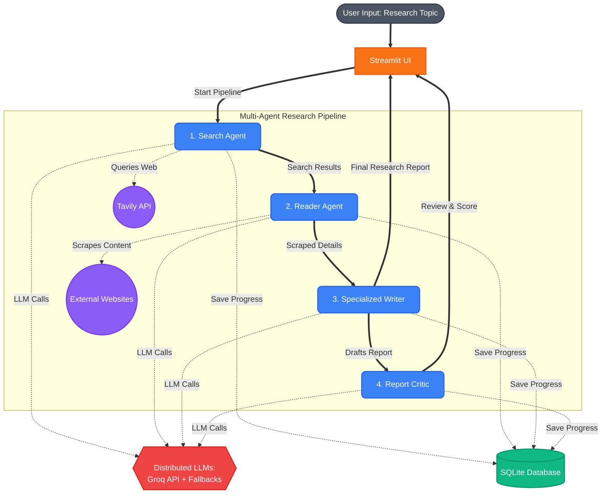

# 🧐 ResearchMind - Multi-Agent AI System

ResearchMind is an advanced, multi-agent AI research assistant built with Streamlit, LangChain, and Groq's high-performance LLM APIs. By employing a sequential pipeline of specialized AI agents and chains, the application can autonomously query the web, scrape in-depth content from relevant sources, draft a comprehensive and structured research report, and provide an objective critique of its own output. 

## Features

- **Search Agent**: Queries the web for recent and reliable information using the Tavily Search API.
- **Reader Agent**: Autonomously selects the most relevant URL from the search results and scrapes its text content.
- **Specialized Writer**: Processes all gathered context to draft a professional, well-structured research report in Markdown.
- **Report Critic**: Evaluates the drafted report for quality, accuracy, and depth, providing a score and actionable feedback.
- **Session Management**: Automatically saves progress and research history into a local SQLite database. Includes safe deletion with confirmation dialogs.
- **Modern UI**: A sleek, custom-styled interface built entirely using Streamlit, featuring responsive design, interactive chips, and polished micro-animations.
- **Distributed Multi-Model AI Pipeline**: Intelligently routes tasks across specialized LLMs (e.g. `gpt-oss-120b`, `llama-3.3-70b-versatile`, and `gpt-oss-20b`) to balance load and preserve high-tier API quota. It utilizes fail-fast fallback logic to gracefully handle rate limits and capacity constraints without freezing the UI.
## Architecture & Workflow

The architecture follows a linear, four-step pipeline managed through Streamlit's session state.



### Pipeline Details

1. **User Input:** The user provides a research topic via the Streamlit UI.
2. **Search Agent:** A LangChain agent (`build_search_agent`) initialized with a `web_search` tool interacts with the Tavily API to gather initial findings and top URLs.
3. **Reader Agent:** A second LangChain agent (`build_reader_agent`) equipped with a `scrape_url` tool is prompted to pick the most relevant URL from the Search Agent's results and scrape its content.
4. **Specialized Writer:** The search results and scraped website content are merged and passed through a LangChain LCEL pipeline (`writer_chain`) to formulate a detailed markdown report.
5. **Report Critic:** The generated report is then sent to another LCEL chain (`critic_chain`) which reviews the text and returns a critical evaluation and a score out of 10. The prompt spacing is optimized for browser rendering using HTML non-breaking spaces.

## Getting Started

### Prerequisites

- Python 3.10+
- An API key for [Groq](https://console.groq.com/)
- An API key for [Tavily](https://tavily.com/)

### Setup

1. **Clone the repository.**
2. **Install dependencies (uv is recommended):**
   ```bash
   uv sync
   # or pip install -r requirements.txt
   ```
3. **Configure Environment Variables:**
   Create a `.env` file in the root directory and add your keys:
   ```env
   GROQ_API_KEY=your_groq_api_key_here
   TAVILY_API_KEY=your_tavily_api_key_here
   ```
4. **Run the application:**
   ```bash
   uv run streamlit run app.py
   ```
