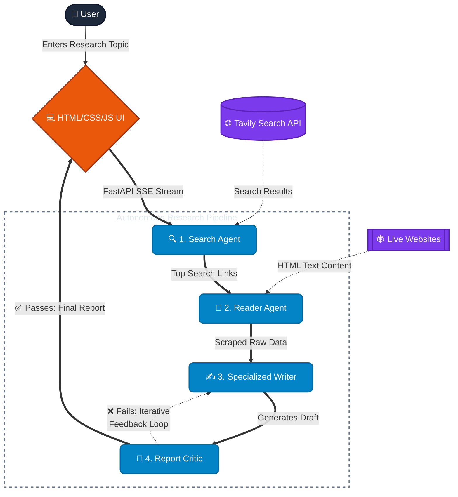

# 🧐 ResearchMind - Multi-Agent AI System

ResearchMind is an advanced, multi-agent AI research assistant built with a native **HTML5, Vanilla CSS, and JavaScript** frontend, powered by a high-performance **FastAPI** backend, LangChain, and Groq & Google Gemini LLM APIs. By employing a sequential pipeline of specialized AI agents and chains, the application autonomously queries the web, scrapes in-depth content from relevant sources, drafts a comprehensive research report, and provides an objective critique of its output.

## Features

- **Ultra-Smooth Web UI**: Built 100% in pure HTML5, Vanilla CSS, and JavaScript with 60fps hardware-accelerated animations, zero-lag client state transitions, and responsive mobile-first layout.
- **Real-Time SSE Streaming**: Seamless Server-Sent Events stream pipeline status, live spinning indicators, and report drafts using a silky typewriter effect without blocking user interactions.
- **Search Agent**: Queries the web for recent and reliable information using the Tavily Search API.
- **Reader Agent**: Autonomously selects the most relevant URL from search results and extracts deep content.
- **Specialized Writer**: Synthesizes gathered intelligence to draft a structured, professional report in Markdown.
- **Report Critic**: Evaluates the report for quality, accuracy, and depth with an automated star rating, actionable strengths, and areas to improve.
- **Session History & Filter**: Real-time searchable history saved to local SQLite. Load any past research session instantly with 0ms lag, or delete safely via a confirmation modal.
- **LaTeX Math & Markdown**: Native formula rendering via KaTeX (`$E=mc^2$` and `$$\sum...$$`) and rich tables.
- **Export Capabilities**: Download reports natively as Word Documents (`.docx`) or Markdown (`.md`) files with one click.
- **Iterative Self-Correction**: Report Critic can reject a draft and trigger up to 3 iterative revisions by the Writer Agent.
- **Fail-Fast Fallbacks**: Robust routing across Groq LLMs (`gpt-oss-120b`, `gpt-oss-20b`) with Google Gemini fallbacks (`gemini-2.5-flash`, `gemini-3.5-flash`).

## Architecture & Workflow



## Getting Started

### Prerequisites

- Python 3.10+
- An API key for [Groq](https://console.groq.com/)
- An API key for [Google Gemini](https://aistudio.google.com/)
- An API key for [Tavily](https://tavily.com/)

### Setup

1. **Clone the repository.**
2. **Install dependencies (uv is recommended):**
   ```bash
   uv sync
   # or pip install -r requirements.txt
   ```
3. **Configure Environment Variables:**
   Create a `.env` file in the root directory:
   ```env
   GROQ_API_KEY=your_groq_api_key_here
   GOOGLE_API_KEY=your_google_api_key_here
   TAVILY_API_KEY=your_tavily_api_key_here
   ```
4. **Run the application:**
   ```bash
   uv run python app.py
   ```
   Open **[http://localhost:8000](http://localhost:8000)** in your browser.
