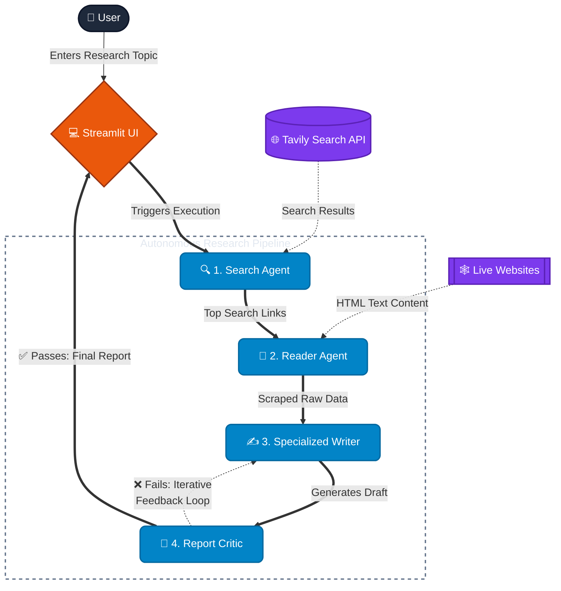

# 🧐 ResearchMind - Multi-Agent AI System

ResearchMind is an advanced, multi-agent AI research assistant built with Streamlit, LangChain, alongside Groq and Google Gemini's high-performance LLM APIs. By employing a sequential pipeline of specialized AI agents and chains, the application can autonomously query the web, scrape in-depth content from relevant sources, draft a comprehensive and structured research report, and provide an objective critique of its own output. 

## Features

- **Search Agent**: Queries the web for recent and reliable information using the Tavily Search API.
- **Reader Agent**: Autonomously selects the most relevant URL from the search results and scrapes its text content.
- **Specialized Writer**: Processes all gathered context to draft a professional, well-structured research report in Markdown.
- **Report Critic**: Evaluates the drafted report for quality, accuracy, and depth, providing a score and actionable feedback.
- **Session Management**: Automatically saves progress and research history into a local SQLite database. Includes safe deletion with confirmation dialogs, as well as the ability to seamlessly **Resume**, **Restart**, or start a **New Research** task from existing sessions.
- **Advanced Export Capabilities**: Download final reports natively as high-quality Word Documents (`.docx`) or Markdown (`.md`) files.
- **Modern UI & Streaming**: A sleek, custom-styled interface built entirely using Streamlit, featuring responsive design, custom button styling, and polished micro-animations. Agent responses now feature a **typewriter streaming effect** for an engaging, real-time user experience.
- **Strict Formatting Guardrails**: Built-in prompt engineering explicitly enforces strict Markdown and LaTeX rules, preventing Streamlit rendering bugs when generating tables or complex math equations.
- **Iterative Self-Correction**: Features an autonomous re-evaluation loop where the Report Critic can reject a draft and send feedback back to the Writer Agent for up to 3 iterative revisions.
- **Robust Multi-Model Architecture**: Intelligently routes tasks across specialized Groq LLMs (e.g., `gpt-oss-120b`, `gpt-oss-20b`) with built-in fail-fast fallbacks to Google Gemini models (`gemini-2.5-flash`, `gemini-3.5-flash`). This ensures high stability, preserves API quota, and gracefully handles rate limits without freezing the UI.
## Architecture & Workflow

The architecture follows a linear, four-step pipeline managed through Streamlit's session state.



### Pipeline Details

1. **User Input:** The user provides a research topic via the Streamlit UI.
2. **Search Agent:** A LangChain agent (`build_search_agent`) initialized with a `web_search` tool interacts with the Tavily API to gather initial findings and top URLs.
3. **Reader Agent:** A second LangChain agent (`build_reader_agent`) equipped with a `scrape_url` tool is prompted to pick the most relevant URL from the Search Agent's results and scrape its content.
4. **Specialized Writer:** The search results and scraped website content are merged and passed through a LangChain LCEL pipeline (`writer_chain`) to formulate a detailed markdown report.
5. **Report Critic:** The generated report is then sent to another LCEL chain (`critic_chain`) which reviews the text and returns a critical evaluation. If the report needs improvement, the Critic feeds its review back to the Writer for up to 3 iterative revisions. The final result is displayed to the user.

## Getting Started

### Prerequisites

- Python 3.10+
- An API key for [Groq](https://console.groq.com/)
- An API key for [Google Gemini](https://aistudio.google.com/)
- An API key for [Tavily](https://tavily.com/)

### Setup

1. **Clone the repository.**
2. **Install dependencies (uv is recommended):**
   ```bash
   uv sync
   # or pip install -r requirements.txt
   ```
3. **Configure Environment Variables:**
   Create a `.env` file in the root directory and add your keys:
   ```env
   GROQ_API_KEY=your_groq_api_key_here
   GOOGLE_API_KEY=your_google_api_key_here
   TAVILY_API_KEY=your_tavily_api_key_here
   ```
4. **Run the application:**
   ```bash
   uv run streamlit run app.py
   ```
